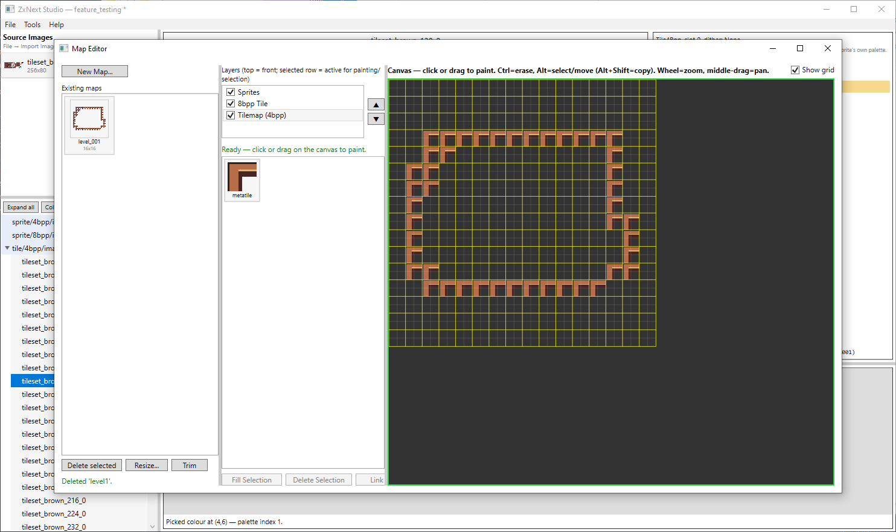
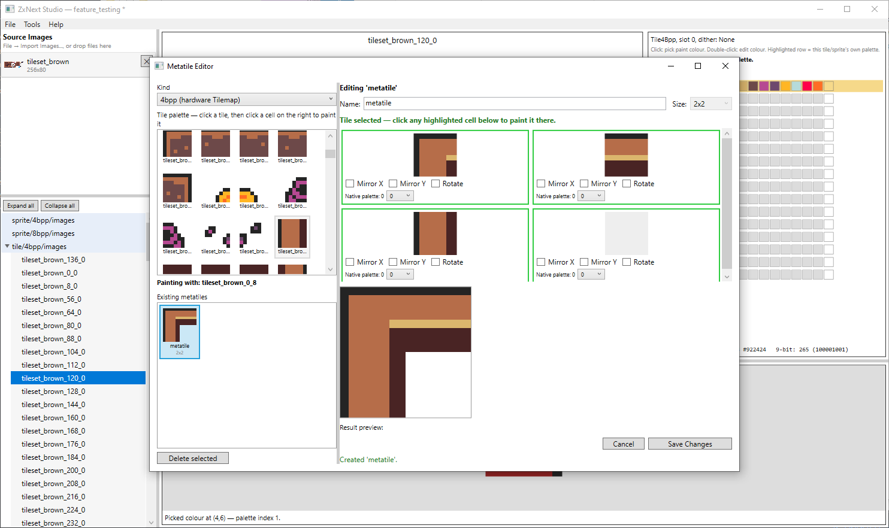
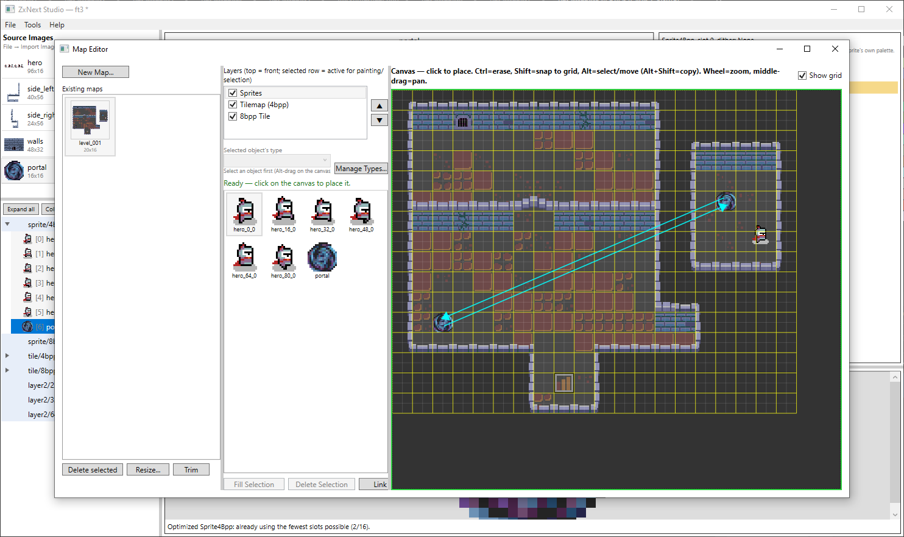
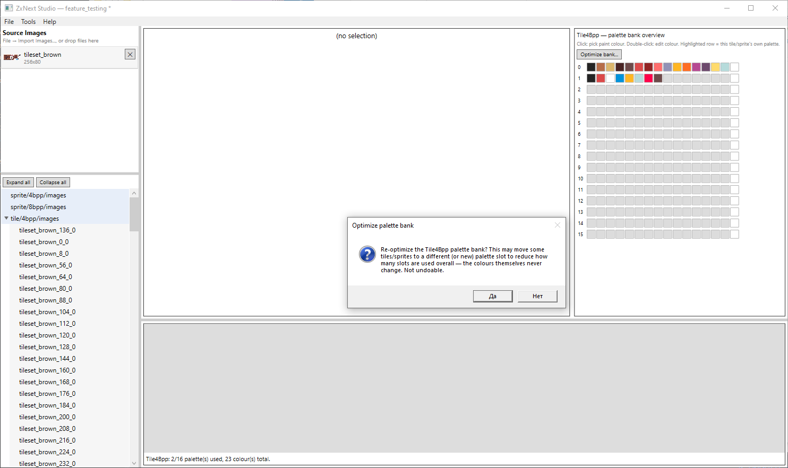
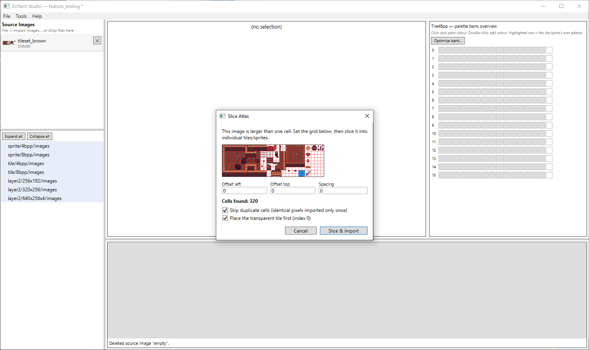
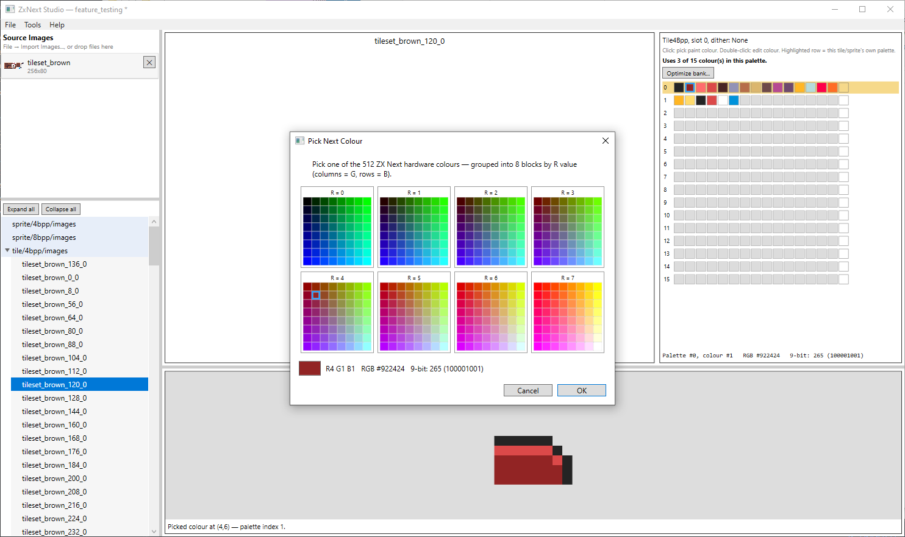

# ZxNext Studio

A Windows desktop tool (WPF, .NET 9) that converts ordinary images into native [ZX Spectrum Next](https://www.specnext.com/) graphics (sprites, tiles, full-screen Layer2 bitmaps, and tile-based maps with typed, linkable objects), with correct palette allocation, optional dithering, manual pixel/palette editing, and a ready-to-assemble Z80 export.

> Built with [Claude Code](https://claude.com/claude-code) using the Claude Sonnet 5 model.

## Screenshots

Painting a map across the Tilemap/8bpp-Tile/Sprite layers, with a metatile selected for painting:



The Metatile Editor: composing a reusable 2x2 block from individual tiles, with per-cell mirror/rotate:



Two placed objects linked with a directed arrow (e.g. a switch tied to a specific door):



The 4bpp palette-bank overview, with "Optimize bank" about to repack tiles into fewer slots:



Slicing an oversized source image into individual 4bpp tiles, with duplicate-cell skipping:



The genuine 512-colour Next picker, grouped into 8 blocks by R value:



## Demo

[ZxNextStudio-TechDemo](https://github.com/serdjukdev/ZxNextStudio-TechDemo) is a small ZX Spectrum Next tech demo built entirely from data exported here: all three layer types (Tilemap, Layer2, Sprites) rendered at once, animated player movement, wall collision, and a portal that teleports the player via an object link.

## Features

- **Import**: drag-and-drop a source image onto a category folder, `File → Import Images...`, or click into the Source Images panel and press Ctrl+V to paste an image from the clipboard (screenshots, Snipping Tool, most editors). If the pasted image had no alpha channel in the clipboard (a known limitation of some apps' copy, including some Photoshop versions, which may also crop away any transparent border before copying, shrinking the image), a warning says so; export/save as PNG and import the file instead if transparency or exact size matters. An image larger than the target cell size opens an atlas-slicer dialog (grid overlay, offset/spacing controls, duplicate-cell skipping, and a click-to-toggle preview so any cell/block can be included or excluded by hand) instead of failing. For tile categories, the slicer can also cut straight into the project's metatile blocks (16×16/24×24/32×32, matching the fixed metatile size): each block's tiles are imported with duplicates reused, and a metatile is auto-built from the result, unless the block's whole tile composition exactly duplicates an earlier block's in the same slice, in which case that existing metatile is reused instead. Tile4Bpp's real 256-tile hardware limit (and the 255-metatile-per-Kind limit in block mode) is enforced right there in the dialog: the default selection fills up to whatever's left, and clicking past it is refused rather than failing later at export. A source image whose size isn't an exact multiple of the cell size can optionally pad its trailing row/column with transparent pixels instead of dropping it.
- **Asset categories**, each with its own cell size and palette model:

  | Category | Cell size | Palette model |
  |---|---|---|
  | Sprite 4bpp / Tile 4bpp | 16×16 / 8×8 | Shared 16-slot palette bank (15 usable colours/slot), auto-allocated across the whole category (Sprite4Bpp sub-folders included) |
  | Sprite 8bpp / Tile 8bpp | 16×16 / 8×8 | One flat 256-colour palette shared across the category, sub-folders included |
  | Layer2 256×192 / 320×256 | full screen | One flat 256-colour palette per folder |
  | Layer2 640×256×4 | full screen | One flat 16-colour palette per folder |

- **Colour matching**: pixels are matched against the real Next-512 colour space (3 bits/channel), with a choice of dithering per source image: None, Ordered Bayer 4×4, or Floyd-Steinberg error diffusion (whole-image, so slicing into tiles later never creates dithering seams).
- **4bpp palette allocation**: a real bucketing algorithm (subset-match an existing slot, then merge into the slot needing fewest new colours, then allocate a new slot, else report overflow), plus an "Optimize bank" pass that repacks everything into as few slots as possible without changing any colour.
- **Editing**: click-to-paint pixel editor and a genuine 512-colour picker (no snapping surprises: every colour shown is a real, selectable Next colour), palette-bank overview grid, eyedropper (Ctrl+click in the editable canvas, plain click/drag in the read-only preview above it), a full per-window undo stack.
- **Project tree**: full-row click selection, Ctrl/Shift-click multi-select, right-click bulk delete/re-quantize on a whole selection. Folder rows are colour-coded chips by category type (4bpp / 8bpp / Layer2), with sub-folders a lighter shade of their parent. Every tile/sprite row shows a live thumbnail of its own pixels and its real export index (the exact number that ends up in the exported file); drag one row onto another to reorder it, or across folders (within a shared-palette category) to move it there at a chosen spot. Moving a root sprite or Tile8Bpp tile that is currently placed on a map or used in a metatile into a sub-folder is only allowed when "Allow sub-folder assets in map/metatile editor" is on in Settings. A per-row padlock protects code-referenced assets (animation frames, procedurally drawn tiles) from deletion, a folder's right-click "Delete unused..." sweeps out every tile/sprite no map places, and a Tile8Bpp tile can be flagged Layer2-priority (drawn on top of every layer on hardware). A Sprite4Bpp/Sprite8Bpp sub-folder asset has its own checkbox ("Show in Map Editor") independent of the padlock: any number of sub-folder sprites can be flagged to join the Map Editor's sprite palette alongside root sprites, useful when several animated objects (e.g. different enemies) share one sub-folder "bank". Selecting a Sprite4Bpp/Sprite8Bpp folder (or an asset in it) shows that folder's bank usage against the 16KB shared sprite pattern memory pool in the status line.
- **Bulk operations**: re-quantize a single tile, an entire folder, or the current multi-selection with a different dithering mode; changing dithering on a source image re-quantizes every placement of it immediately.
- **Metatile Editor**: compose reusable blocks of tiles (1×1/2×2/4×4, one fixed size per project, chosen once), with per-cell mirror/rotate and an optional palette-slot override; this is the placeable unit on a map's grid layers. Click a palette tile then click a draft cell to paint it, or drag a tile straight onto a cell instead. Drag one metatile onto another to reorder it; every map placing an affected metatile is rewritten to match automatically. Right-click a metatile (or F2) to rename it directly, without loading it into the draft first; on a 1×1 project that renames its underlying tile too. A "Blank" tile and metatile are auto-generated and always sit at export index 0, undeletable: a real tile pattern for an unpainted/erased map cell to reference, so hardware code never reads past the end of the metatile table or leaves stale VRAM content behind.
- **Tilemap tile animation**: a Tile4Bpp sub-folder is an animation frame bank, kept out of the 256 placeable tilemap tiles and exported as its own binary: on hardware, animating the tilemap is nothing but copying 32 bytes over a tile's pattern, so the whole bank is raw positional tile data (nothing de-duplicated, transparent positions kept). Right-click the folder for "Animation target..." and pick, as a picture, the metatile or the single tile the frames overwrite; the app then derives tiles per frame, frame count and bytes per frame, and enforces the one rule that bites on hardware: every frame tile is quantized into the palette slot of the tile it overwrites (substituting pixels never rewrites a map cell's attribute byte, so no other slot would render correctly), and refused if its colours don't fit there. The export writes the arithmetic out as `tm_anim_<folder>_*` constants (`first`, `tiles`, `frames`, `frame_size`, `offset`), so a frame change is one copy with nothing hardcoded, and it stops with a clear message instead of emitting wrong numbers when a frame is incomplete or a target is gone. Non-consecutive targets get a `targets` table instead of `first`. The copy itself and the frame timing stay in your own Z80 code.
- **Filter by name**: a search box above the Project Tree and every editor palette and list keeps only the items whose name contains what you type, for projects with hundreds of tiles.
- **Map Editor**: paint maps across two metatile grid layers (4bpp Tilemap, 8bpp Tile) plus a freeform Sprite object layer, with three tools, one on at a time (keys B / G / M): Brush (paint cell by cell, Ctrl erases, Shift snaps sprite placement), Fill (a paint bucket: click fills the connected area of the same metatile, drag fills a rectangle, and picking another metatile refills the selected area) and Select (select, move, Shift to copy), an Alt+click eyedropper that picks the metatile or object under the cursor, plus Resize/Trim. Anything pushed past the map's edge, by a shrinking resize, a move, or a paste, is dropped rather than left sitting outside the map, so the exported level never carries an object you cannot see on the canvas. Ctrl+Z/Ctrl+Y undo and redo every edit; Ctrl+C/Ctrl+V copies a selection and pastes it under the cursor, including across different maps in the same project. Save any selected rectangle as a named **Template** (renamed or deleted from its right-click menu) (a reusable multi-cell block, graphics only) and stamp it back onto any grid layer with a matching Kind/GridSize, with a translucent footprint previewing the drop before you click; stored project-wide, so one template can be reused across every map. A live status line under the canvas shows the cursor's raw pixel X/Y plus its tile (and metatile, when the project uses them) cell coordinates and the name of the metatile or object under it. The editor reopens on your last-selected map, and each map remembers its own scroll position, zoom, and active layer between visits. Rendering is cached and incremental, so painting stays responsive even on maps with tens of thousands of cells.
- **Object types, links & user byte**: give any placed object a user-defined type (e.g. "portal", "character"), draw a directed link between two objects (e.g. a button that opens a specific door, shown as an arrow on the canvas), and set a free-form 0-255 user byte (edited as a number or its 8 individual bits, either one updates the other) for whatever a game's own code needs it for. All three are exported as extra bytes per object. Each is also reachable by right-clicking an object directly, as a one-time action that doesn't stay armed the way the toolbar buttons do; right-click with an active sprite selection (Alt-drag a box first) instead applies the picked type or user byte to every selected object at once, as one undo step. Object types can be reordered with Move Up/Down in "Manage Types..."; that order sets both the type's exported `equ` number and the init order of its objects within each map's exported object list, with untyped objects always initializing last (objects keep their placement order within one type's own group; the exported `connect` byte always points at the right link target regardless of this reordering).
- **Replace image**: right-click any tile, sprite or Layer2 image for "Replace image..." to give it a new picture while it stays the same asset: same name, same export index (so nothing hardcoded in your Z80 code moves), same lock and tree position, and every metatile cell, map placement and animation target that uses it keeps working. The picture comes from a source image in the project ("Browse..." adds a file to that list first, so the asset keeps a live source link and can still be re-quantized later), and the old source image is released, becoming a plain one-question delete once nothing else is made from it. The picker is a resizable zoomable preview: wheel to zoom around the cursor, middle-button drag to pan, left click to jump to a whole cell, arrow keys to move the selection pixel by pixel, plus an "Image offset" pair for a sheet whose cell grid does not start at 0,0. Layer2 images place freely against their canvas instead, padded with transparent like on  import. A whole **metatile** can be replaced the same way, from its right-click menu in the Metatile Editor: the picked footprint-sized region is cut into the metatile's cells and each cell's tile is replaced in place, with a confirmation first for the cases that are not obvious (a tile shared by two cells, a currently blank cell, mirror/rotate flags, and the other metatiles built from the same tiles).
- **Objects on the map**: the Map Editor's Sprite-layer palette has an "objects" tab (the default once any object exists) beside the original "root" sprite tab. An object is shown by its whole picture, placed with a click (Shift snaps it to the 8x8 tile grid, with a preview sized to the object), and drawn on the map in full. It brings its type and user byte with it, exports its own measured width/height in its extended bytes, and is selected, erased, marquee-picked and outlined by its real area rather than by its base sprite's 16x16.
- **Object Editor**: build a named object out of SPRITES and place it on a map as one unit. Rows rather than a rectangle: each row has its own cell count and its own pixel offset, so a 5-wide platform or a character of one sprite over two (its lower row centred at dx -8) describes itself with no filler cells, and one sprite can repeat across as many cells as needed. A folder strip over the sprite palette reaches sub-folder sprites too, in their real project order. Each object carries the type and user byte its placements start with (number, bits and named subtypes edited in place) plus its size in pixels, measured from the picture or typed by hand when the exported size is a hitbox rather than the picture's extent. A placement made from an object writes that object's measured width and height into its extended bytes; the layout itself reaches the export only through the object's animation tables (below), never through the placement's record, since your own code picks the real sprites from the type and user byte.
- **Object animations**: an object holds named ANIMATIONS, each a list of frames, and a frame is one row layout plus how long it is held (a still object is simply a one-frame animation). An animation strip and a frame strip sit above the row editor: Add/Rename/Delete/drag for animations, "Add frame" copying the selected frame, thumbnails with per-frame duration, drag to reorder, and clicking a frame loads it into the row editor. Each animation exports one self-contained table into `object_anims.asm` for your own sprite routine: frame count then one `dw` per frame, and per frame just its duration and its sprite count, then the anchor sprite as `db palette, pattern` with no offset, then `db dx, dy, palette, pattern` per following sprite with signed offsets from the anchor. Each sprite carries its own palette slot, pre-shifted into bits 7:4, so a frame may mix slots; every animation also gets an `obj_<object>_<animation>: equ` alias so your code names it rather than its address.
- **Object subtypes**: name the individual bits of a placed object's user byte, per object type, on the Object Editor's Types tab (up to 8, one bit each; a new one takes the lowest free bit and can be moved later). On the map, "Set User Byte" then offers that type's subtypes by name: picking one sets its bit and clears the other subtype bits, while bits no subtype owns stay exactly as you typed them, so one byte can carry both a named variant and a hand-entered parameter. Exported as `subobj_<name>: equ <bit value>`, unique project-wide.
- **Hitbox**: an object's collision box is drawn BY HAND over its own art, in the Object Editor's "Hitbox..." window: drag the box, drag a handle on any side or corner, or type the four numbers. The box is what the game knows the object by, so a placement exports the BOX's corner as its X/Y, and its record carries `drawX`/`drawY` (minus the box's offset) to get back to the picture with one addition. Nothing is measured or auto-fitted, and the default is the old behaviour exactly: box at the anchor sprite, as big as the picture, `drawX = drawY = 0`.
- **Extended object bytes**: an optional four bytes per exported object (width and height of the box in pixels, then the signed `drawX`, `drawY`), with the size resolved for each placement from the strongest source available: a value pinned on that placement via the Map Editor's right-click "Object Data...", else the named object it was stamped from (its hitbox, or its measured picture), else its type's default on the Object Editor's Types tab, else the sprite's own pixel size. They are always written inside an `IFDEF OBJ_EXT` block, with a matching `<map>_objects_obj_size` constant (8 or 12), and the one `DEFINE OBJ_EXT` line that switches them on lives in the project-wide `object_types.asm`: flip the Settings checkbox, or uncomment that line by hand, and every map's records change length together with no re-export. With it off the export is byte-for-byte what it was before. There is no palette byte: a sprite's palette is exported with the sprite, in the object's animation table.
- **Export all metatiles**: a per-project Settings option (off by default). Off, each map layer's `_metatiles` file holds only the metatiles that layer places; on, it holds every metatile of that kind, placed or not, so your code can swap in metatiles the map never shows (grid bytes then count among all of them).
- **Projects**: saved as a single `.zxngc` file (a zip of the manifest, source images, and converted asset data); recent-projects list; auto-opens the last project on launch; unsaved-changes tracking with a save-before-closing prompt.
- **Export for Next**: every asset folder (or, for Layer2, each image) packs into binary chunks plus a matching Z80 ASM address map, with a per-row choice of chunk size (8KB/16KB/whole file) and, for software-blitted Tile8Bpp assets, row-major vs column-major pixel order. Sprite/tile assets are labelled by name in the ASM (`s4_`/`t4_`/`s8_`/`t8_` prefixes), and every map object and metatile gets its own address label on its record, so game code can reference an asset, a metatile, or a placement by name with no offset arithmetic. Each Sprite4Bpp sprite and Tile4Bpp tile also gets its palette as a zero-byte `equ` constant, pre-shifted into the high nibble the hardware reads (`s4_hero_pal: equ 32`), so naming a palette in your own code costs no memory; the same slots are additionally available as a real lookup table (`s4_pal_table + spriteIndex`), which the Settings option "Export palette lookup tables" can drop when nothing reads it at runtime. Each map exports separately (grid layers, metatiles, and objects embedded directly as `db` bytes, no chunking), plus one project-wide `object_types.asm` shared by every map; each map also gets a `<map>_info.asm` geometry row, one sjasmplus `MODULE <map name>` with the whole map measured out as short-named `equ` constants (width/height in metatile cells, 8×8 tiles and pixels, all four sides as inclusive extreme coordinates in those same three units, the metatile cell size with ready-made shift counts, each grid layer's bytes-per-cell, row stride and total size) plus an `hdr:` block repeating the same numbers as real `dw`/`db` data, for engine code handed a pointer to a map instead of assembled against one; each map's objects file also writes a `_count` constant per project-wide Object Type (even one placing 0 objects on that particular map), alongside the overall `_count`, plus a block address label right before each type's first object (none for a type placing 0 objects, or for untyped objects). The export dialog previews every row live before you commit, and shows a bright red warning banner listing any placed object across any map that has no type assigned (non-blocking, a heads-up for a forgotten "Set Type..."). Three Settings options shape the export: "Organise output into sub-folders" mirrors the project tree (each asset category gets its own named sub-folder, user sub-folders nest inside it, map grid/metatile files land in their tile-category folder); "Allow sub-folder assets in map/metatile editor" lets sub-folder sprites and tiles be placed on maps and in metatiles, with their export index local to the sub-folder binary; "Set ULA-over-tilemap bit (bit 0) on every exported Tilemap attribute byte" forces bit 0 of every 4bpp Tilemap tile's attribute byte (the GridSize=1 direct-cell format and every metatile cell alike) to 1 instead of the default 0, matching nextreg 0x6C's per-tile ULA-over-tilemap priority flag; one project-wide switch, not a per-tile choice. Sprite4Bpp sub-folders also get a `s4_<subfolder>_pal_table:` label for indexed palette slot lookup.
- **Help**: an in-app Help screen (Help menu or F1) documenting every button, shortcut, and export byte format.

## Getting started

Requirements: Windows, [.NET 9 SDK](https://dotnet.microsoft.com/download).

Prefer not to build from source? The [Releases](https://github.com/serdjukdev/ZxNextGraphicsConverter/releases) page has ready-to-run Windows builds plus a sample `.zxngc` project you can open right away.

```powershell
# Build everything
dotnet build ZxNextGraphicsConverter.sln

# Run the app
dotnet run --project src/ZxNext.App

# Run the Core test suite
dotnet test tests/ZxNext.Core.Tests
```

## Project structure

```
src/ZxNext.Core/    Conversion, quantization, palette allocation, project persistence, export. Plain C#, no UI/WPF dependency.
src/ZxNext.App/     WPF UI (MVVM, CommunityToolkit.Mvvm): views, view models, dialogs.
tests/ZxNext.Core.Tests/   xUnit tests over ZxNext.Core.
```

`ZxNext.Core` is deliberately UI-agnostic: every conversion, palette, and export decision lives there and is unit-tested independently of WPF.

## Support

If you find this useful, you can support its development on [Patreon](https://www.patreon.com/cw/Serdjuk) or [Ko-fi](https://ko-fi.com/serdjuk).

## License

[PolyForm Noncommercial 1.0.0](LICENSE): free to use, modify, and share for noncommercial purposes; commercial use (including selling this software or a derivative of it) is not permitted without a separate agreement with the author.
